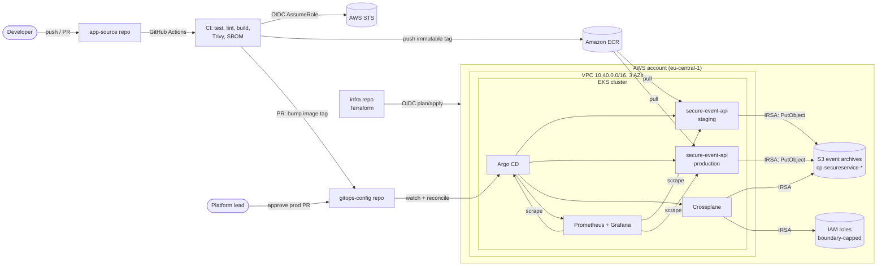
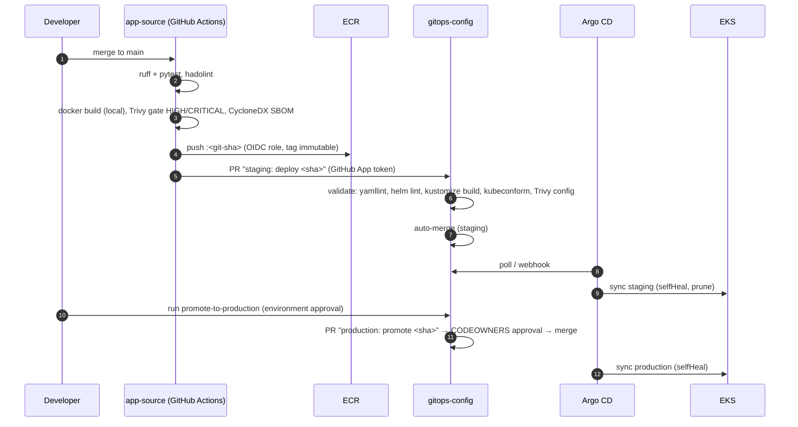
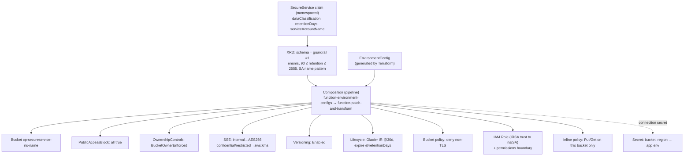

# Secure GitOps Platform on AWS EKS

An end-to-end platform-engineering project: Terraform builds a multi-AZ EKS foundation, Argo CD
delivers everything from Git, Crossplane exposes a self-service `SecureService` API with security
guardrails, GitHub Actions ships scanned and SBOM-documented images through OIDC (no AWS access keys
in CI), and Prometheus/Grafana plus a Python `platform-doctor` tool support an incident exercise that
ends in a Git-based rollback and an RCA.

> A personal portfolio project covering Cloud, DevOps and SRE work (AWS, Kubernetes, GitOps, IaC,
> CI/CD security, observability, Python). It runs in my own AWS account; the incident below was a
> planned exercise in staging, not a customer-facing outage.

### Status: built, deployed and exercised (October 2026)

The platform was built and run live in AWS `eu-central-1` (EKS 1.33, 3 × m7i-flex.large), not just
validated offline. What actually happened, with evidence:

| What | Evidence |
|---|---|
| CI → ECR → GitOps PR → Argo CD, end to end | app-source [PR #1](https://github.com/momenckhouse-dev/app-source/pull/1) → bot [PR #9](https://github.com/momenckhouse-dev/gitops-config/pull/9) deployed `ef872a3e3dde` to staging |
| Approval-gated production promotion | `promote.yml` paused at the `production` environment gate, approved, bot [PR #10](https://github.com/momenckhouse-dev/gitops-config/pull/10) merged by hand; 3 production pods rolled out |
| Crossplane provisioning | `SecureService` claims created real S3 buckets and IRSA roles for staging and production; the app archived events to them |
| Incident exercise and recovery | defective release [PR #5](https://github.com/momenckhouse-dev/gitops-config/pull/5), alerts fired, rollback [PR #6](https://github.com/momenckhouse-dev/gitops-config/pull/6) via `git revert`; [RCA INC-2026-001](ops/incidents/INC-2026-001-secure-event-api-oom.md) with measured timeline and impact |
| Fixes found by running it | sync-wave deadlock ([PR #3](https://github.com/momenckhouse-dev/gitops-config/pull/3)), false EKS control-plane alerts ([PR #4](https://github.com/momenckhouse-dev/gitops-config/pull/4)), capacity alerts and dashboard fix from the RCA ([PR #7](https://github.com/momenckhouse-dev/gitops-config/pull/7)), bot-authored promotion PRs ([PR #8](https://github.com/momenckhouse-dev/gitops-config/pull/8)) |

**Final state before teardown:** all 10 Argo CD applications Synced and Healthy; staging (2 pods) and
production (3 pods) both running image `ef872a3e3dde`; both archive buckets Ready; no alerts firing
apart from the Watchdog heartbeat.

**Torn down on 2026-10-13** in the order in section 7: Crossplane deleted its buckets and IAM roles,
the monitoring volumes were released, and `terraform destroy` removed the remaining 92 resources. A
final check found no leftover clusters, instances, volumes, NAT gateways, IPs or buckets. The setup
guide in section 4 is kept for anyone who wants to build it themselves; the links above are the lasting
evidence.

---

## Contents

1. [Architecture](#1-architecture)
2. [Repository layout](#2-repository-layout)
3. [What has been verified](#3-what-has-been-verified)
4. [Step-by-step implementation](#4-step-by-step-implementation)
5. [Key design decisions](#5-key-design-decisions)
6. [Incident exercise](#6-incident-exercise)
7. [Cost and teardown](#7-cost-and-teardown)
8. [Resume Takeaway](#8-resume-takeaway)

---

## 1. Architecture

### 1.1 System overview



### 1.2 Delivery flow (CI → GitOps → CD)



### 1.3 SecureService platform API (Crossplane)



Guardrails are layered: the XRD rejects bad input, the Composition hard-codes security settings
developers cannot override, and the Crossplane provider's own IAM role can **only** create roles that
carry the permissions boundary, and only touch `cp-secureservice-*` buckets.

### 1.4 Network layout

```
VPC 10.40.0.0/16                      eu-central-1a     eu-central-1b     eu-central-1c
  public  /24  (ALB, NAT GW)          10.40.48.0/24     10.40.49.0/24     10.40.50.0/24
  private /20  (nodes, pods)          10.40.0.0/20      10.40.16.0/20     10.40.32.0/20
  intra   /24  (EKS control-plane ENIs) 10.40.52.0/24   10.40.53.0/24     10.40.54.0/24
  + S3 gateway endpoint, VPC flow logs → CloudWatch (60 s aggregation)
```

---

## 2. Repository layout

The platform is **three repositories**. This README lives in `gitops-config`, the hub of the platform.
Commands in this README assume all three are cloned side by side in one workspace folder:

```bash
mkdir secure-platform && cd secure-platform
git clone https://github.com/momenckhouse-dev/app-source.git
git clone https://github.com/momenckhouse-dev/gitops-config.git
git clone https://github.com/momenckhouse-dev/infra.git
```

The split between application source and deployment config is deliberate (see section 5).

```
app-source/                 # repo 1: application code + CI
  src/secure_event_api/       Flask API, Prometheus metrics, S3 archiver, fault-injection hook
  tests/                      24 unit tests
  Dockerfile                  multi-stage, non-root uid 10001, gunicorn
  .github/workflows/ci.yml    test → lint → build → Trivy → SBOM → ECR (OIDC) → GitOps PR

gitops-config/              # repo 2: desired state of the cluster
  charts/secure-event-api/    custom Helm chart (Deployment, HPA, PDB, NetworkPolicy, ServiceMonitor, SecureService claim)
  environments/base           kustomize helmCharts inflation of the chart
  environments/staging        overlay: namespace, image pin, IRSA role, retention 90d
  environments/production     overlay: + bigger limits, HPA 3-10, PDB 2, restricted + 7-year retention
  argocd/bootstrap/           Argo CD Helm values + the root app (only manually applied manifest)
  argocd/managed/             app-of-apps: projects, platform apps, workload apps
  platform/crossplane/        providers + functions, XRD, Composition, EnvironmentConfig, example claim
  platform/monitoring/        kube-prometheus-stack values, PrometheusRules, Grafana dashboard
  ops/platform-doctor/        health-report CLI + 17 tests + healthy/incident snapshots
  ops/incident-sim/           defective-release injector, load generator, exercise guide
  ops/runbooks/               rollback-via-git, crashloop/OOM, error rate, Argo CD degraded, node NotReady
  ops/incidents/              INC-2026-001 RCA + template
  scripts/                    run_local_checks.ps1 + validate_repo.py (check all three repos locally)
  .github/workflows/          validate.yml (every PR, incl. ops tests), promote.yml (approval-gated)
  .github/CODEOWNERS          owners for production/**, platform/** and argocd/**

infra/                      # repo 3: Terraform foundation
  terraform/                  VPC, EKS, ECR, GitHub OIDC roles, Crossplane IRSA + boundary
  .trivyignore                documented accepted risks for the IaC scan
  .github/workflows/          fmt → validate → tflint → Trivy IaC → plan (PR) → apply (approved env)
```

---

## 3. What has been verified

### 3.1 Offline checks

From the workspace folder, run `.\gitops-config\scripts\run_local_checks.ps1` (Windows) to repeat all of
this. Re-run on 2026-10-12:

| Check | Result |
|---|---|
| App unit tests (pytest) | **24/24 pass** |
| platform-doctor tests | **17/17 pass** |
| ruff lint + format (app and ops) | clean |
| Repo static validation | 39 YAML, 19 JSON, 4 kustomizations, 10 Argo CD apps, 4 workflows: OK |
| `helm lint --strict` | pass |
| `kustomize build --enable-helm` staging / production / monitoring | renders 9 resource kinds per env; image, namespace, patches verified |
| `terraform fmt -check` + `terraform validate` (AWS provider 5.x, EKS module 20.37, VPC 5.21) | **valid** |
| Live app smoke test with load | healthy build flat at 60 MB; defective build 60 → 350 MB after 289 requests |
| Git rollback rehearsal | inject bad release → commit → render shows bad tag + fault → `git revert` → render shows good tag |
| platform-doctor exit codes | healthy fixture → 0, incident fixture → 2 |

### 3.2 Live checks on AWS (2026-10-12)

| Check | Result |
|---|---|
| GitHub Actions (app CI, gitops validate, promote) | green on `main`; OIDC role assumed, image scanned and pushed to ECR, bot PRs opened |
| Terraform | applied from a workstation with an IAM user's access keys; CI runs fmt, validate, tflint and Trivy IaC. The OIDC plan/apply jobs are wired but not enabled yet |
| Argo CD | 10 apps Synced/Healthy; staging auto-deploys; production promoted through the approval gate |
| Crossplane | both `SecureService` claims Ready: real S3 buckets and IRSA roles; events archived without stored credentials |
| Prometheus alerting | `ContainerOOMKilled` and `SecureEventApiRestarting` fired 2.5 min after the defective rollout and resolved after the revert |
| End-to-end requests | staging and production: `201` responses, objects present in each environment's archive bucket |

Running it live found real problems that offline checks could not: an Argo CD sync-wave deadlock,
AppProjects created after their Applications, false control-plane alerts on EKS, a 5xx alert that
is blind to crash loops, and a promotion workflow whose PRs could never pass required checks. Each
fix is linked in the status table at the top.

---

## 4. Step-by-step implementation

### Phase 0: Prerequisites

- AWS account with admin access for the first apply; AWS CLI v2.
- GitHub organisation (or user) and three repos: `app-source`, `gitops-config`, `infra`.
- Tools: Terraform ≥ 1.6, kubectl, Helm 3, kustomize 5, Argo CD CLI, `gh`, Docker, Python 3.11+.
- The repos contain the values of my deployment. To build your own, replace them everywhere:

  | Value in the repos | Replace with |
  |---|---|
  | `momenckhouse-dev` | your GitHub org/user |
  | `071975552383` | your AWS account ID |
  | `eu-central-1` | your region (if different) |
  | the EKS OIDC provider ID in `environment-config.yaml` | written for you by Terraform output in Phase 3 |

  ```bash
  grep -rl "momenckhouse-dev\|071975552383\|eu-central-1" --exclude-dir=.venv .
  ```

### Phase 1: Terraform state and foundation (from your laptop, once)

```bash
aws s3api create-bucket --bucket <tfstate-bucket> --region eu-central-1 \
  --create-bucket-configuration LocationConstraint=eu-central-1
aws s3api put-bucket-versioning --bucket <tfstate-bucket> --versioning-configuration Status=Enabled

cd infra/terraform
cp backend.hcl.example backend.hcl            # set bucket
cp terraform.tfvars.example terraform.tfvars  # set github_org, your IP, your admin role ARN
terraform init -backend-config=backend.hcl
terraform plan -out tfplan && terraform apply tfplan     # ~15-20 min
$(terraform output -raw update_kubeconfig_command)
kubectl get nodes                                         # 3 nodes across 3 AZs
```

The first apply runs locally because the GitHub OIDC roles don't exist until it finishes. After that,
the `infra` repo's workflow owns all changes: PRs get a read-only plan and merges apply through the
`production-infra` environment approval.

### Phase 2: Wire GitHub to AWS (OIDC) and the repos to each other

1. **app-source** → Settings → Variables: `AWS_CI_ROLE_ARN` = `terraform output -raw github_ci_role_arn`.
2. **infra** → Variables: `AWS_TF_PLAN_ROLE_ARN`, `AWS_TF_APPLY_ROLE_ARN`; Environment `production-infra` with required reviewers.
3. Create a **GitHub App** ("gitops-bot") with *Contents: RW, Pull requests: RW* on `gitops-config`;
   in app-source set `GITOPS_BOT_APP_ID` (variable) and `GITOPS_BOT_PRIVATE_KEY` (secret).
4. **gitops-config** → Environment `production` with required reviewers; branch protection on `main`:
   PR required, 1 CODEOWNERS approval, status check `validate`, allow auto-merge.

There are no AWS access keys anywhere: each workflow exchanges its GitHub OIDC token for a
15-60 minute STS session scoped to one repo (and one branch or environment).

### Phase 3: Bootstrap Argo CD (the only manual `kubectl apply`)

```bash
cd infra/terraform
terraform output -raw crossplane_environment_config \
  > ../../gitops-config/platform/crossplane/config/environment-config.yaml
# also put `terraform output -raw crossplane_role_arn` into platform/crossplane/providers/providers.yaml
# and commit + push gitops-config

helm repo add argo https://argoproj.github.io/argo-helm
helm install argocd argo/argo-cd --version 7.7.0 -n argocd --create-namespace \
  -f gitops-config/argocd/bootstrap/argocd-values.yaml \
  --set controller.metrics.serviceMonitor.enabled=false \
  --set server.metrics.serviceMonitor.enabled=false \
  --set repoServer.metrics.serviceMonitor.enabled=false   # Prometheus CRDs don't exist yet

argocd repo add https://github.com/momenckhouse-dev/gitops-config.git --github-app-id ... # if private
kubectl apply -f gitops-config/argocd/bootstrap/root-app.yaml
```

Sync waves bring up the rest in order: storage class (-20) → kube-prometheus-stack (-15) → monitoring
rules and dashboards (-14) → Argo CD manages itself and turns its ServiceMonitors on (-12) →
Crossplane (-10) → providers and functions (-9) → XRD and Composition (-8) → workloads (10).

```bash
argocd app list            # all Synced/Healthy after ~10 min
kubectl get xrd,composition,providers,functions
```

### Phase 4: Prove the platform API

```bash
kubectl create ns team-threat-intel
kubectl apply -f gitops-config/platform/crossplane/examples/secureservice-claim.yaml
kubectl -n team-threat-intel get secureservice events-archive -w    # READY=True in ~1-2 min
aws s3api get-bucket-encryption --bucket cp-secureservice-team-threat-intel-events-archive
aws s3api get-public-access-block --bucket cp-secureservice-team-threat-intel-events-archive
```

Guardrail tests (each must be **rejected**):

```bash
# retention outside 90..2555 or unknown classification → API server rejects (XRD schema)
kubectl -n team-threat-intel patch secureservice events-archive --type merge \
  -p '{"spec":{"parameters":{"retentionDays":5}}}'
```

### Phase 5: Observability

```bash
kubectl -n monitoring create secret generic grafana-admin \
  --from-literal=admin-user=admin --from-literal=admin-password="$(openssl rand -base64 24)"
kubectl -n monitoring port-forward svc/kube-prometheus-stack-grafana 3000:80
```

Grafana → *Platform / Platform Overview*: cluster health, CPU/memory by namespace, per-pod memory vs
limit, restarts, Argo CD app table (sync + health), out-of-sync/degraded counters, app RPS by status,
5xx ratio, p50/p95/p99 latency, and *Running versions* (build + fault mode per pod). Argo CD syncs are
drawn as annotations, so releases line up with metric changes.

```bash
kubectl -n monitoring port-forward svc/kube-prometheus-stack-prometheus 9090:9090 &
python gitops-config/ops/platform-doctor/platform_doctor.py --prometheus-url http://localhost:9090
python gitops-config/ops/platform-doctor/platform_doctor.py --format markdown --output health.md
```

### Phase 6: First release

Push `app-source` to `main`. Watch: tests → hadolint → build → Trivy gate → SBOM artifact → ECR push →
PR in `gitops-config` → `validate` passes → auto-merge → Argo CD syncs staging.

```bash
argocd app get secure-event-api-staging
kubectl -n secure-event-api-staging port-forward svc/secure-event-api 8080:80
curl -s localhost:8080/version
curl -s -XPOST localhost:8080/v1/events -H 'content-type: application/json' \
  -d '{"source":"fw-gw-01","severity":"high","message":"blocked C2 beacon"}'
aws s3 ls s3://cp-secureservice-secure-event-api-staging-events-archive/events/ --recursive
```

### Phase 7: Promote to production (manual approval)

GitHub → gitops-config → Actions → **promote-to-production** → Run. A reviewer approves the
`production` environment, then the workflow (as the GitHub App bot) opens a PR pinning the staging tag in
the production overlay. A human reviews the rendered diff and merges it by hand. Argo CD rolls it out.

**Drift repair demo:** `kubectl -n secure-event-api-production scale deploy secure-event-api --replicas=1`
and watch Argo CD restore it within seconds (`selfHeal`).

### Phase 8: Incident exercise

See [section 6](#6-incident-exercise).

---

## 5. Key design decisions

| Decision | Why |
|---|---|
| **Approval lives in Git, not in Argo CD** | The approval should produce a reviewed, auditable record of exactly what changed. Gating production in Git (the `production` environment approval, then a hand-merged PR) means every production change is a reviewed commit, Git stays the single source of truth, and rollback is `git revert`. Production keeps automated sync with selfHeal, so drift is still repaired. |
| **Separate app and config repos** | CI writes to config only through PRs from a GitHub App; app developers can't change production directly; config history = deployment history; rollback = `git revert`. |
| **Helm chart + Kustomize overlays** | Helm packages the app once with sane secure defaults; overlays hold only environment deltas (and the image pin), so a production diff is small and reviewable. |
| **Scan before push** | The image is built and loaded locally, scanned, and only pushed if it passes, so ECR never holds an unscanned tag. ECR tags are `IMMUTABLE`, so a tag always means the same bytes. |
| **OIDC instead of AWS keys** | No stored long-lived AWS access keys in CI or in the cluster: GitHub Actions gets short-lived STS credentials through OIDC, pinned to repo, branch or environment, and pods use IRSA. GitHub automation uses a GitHub App, whose private key (stored as a secret, scoped to the `production` environment for promotions) mints 1-hour installation tokens. The workstation that runs Terraform uses an IAM user; moving applies to the OIDC CI role is a follow-up. |
| **Permissions boundary on Crossplane-created roles** | Self-service IAM is the riskiest part of a platform API. The Crossplane role cannot create a role without the boundary, cannot remove it, and the boundary only allows object access to `cp-secureservice-*`. |
| **Production `prune: false`** | A bad commit that deletes manifests won't delete production resources; pruning is a deliberate action. |
| **One gunicorn worker per pod** | Prometheus client counters live per process; scale horizontally with replicas/HPA instead. |
| **NetworkPolicy + PSS `restricted` + read-only root FS** | Default-deny posture for workloads; only monitoring and same-namespace traffic reach the pod. |

---

## 6. Incident exercise

Full guide: [ops/incident-sim/README.md](ops/incident-sim/README.md) · RCA:
[ops/incidents/INC-2026-001-secure-event-api-oom.md](ops/incidents/INC-2026-001-secure-event-api-oom.md)

```mermaid
flowchart LR
  A[PR #5: staging<br/>unbounded cache] -->|merge, CI green| B[Argo CD sync<br/>rollout OK]
  B --> C[Memory climbs<br/>OOMKilled 137]
  C --> D[Alerts: OOMKilled, restarts,<br/>crash loop, Argo Degraded]
  D --> E[Grafana: memory vs limit +<br/>Argo CD history = release]
  E --> F[describe + events + platform-doctor:<br/>OOMKilled, BackOff]
  F --> G[git revert → PR #6 → merge]
  G --> H[Argo CD sync → healthy]
  H --> I[RCA + action items]
```



Try it offline right now:

```bash
python gitops-config/ops/platform-doctor/platform_doctor.py --fixture gitops-config/ops/platform-doctor/fixtures/incident
```

---

## 7. Cost and teardown

Rough lab cost as run (eu-central-1, `single_nat_gateway = true`, 3 × m7i-flex.large): EKS control
plane ~$0.10/h, nodes ~$0.30/h, NAT ~$0.05/h plus data, about **$10-12/day**. Production-style settings
(NAT per AZ, larger nodes) roughly double that. On the AWS Free plan only free-tier-eligible instance
types launch (t3.large was rejected), which is why the lab uses m7i-flex.large. Build it, record the
demo, tear it down.

Teardown order. Each step exists because skipping it leaves something behind that keeps costing money
or blocks the next step:

1. **Empty both archive buckets, all object versions.** They are versioned and `forceDestroy: false`,
   so Crossplane cannot delete a bucket that still holds objects.
2. **`kubectl -n argocd delete application root`.** The root app and the two workload apps carry the
   resources finalizer, so the `SecureService` claims are deleted and Crossplane removes the buckets
   and IAM roles it created. Terraform does not know about those, so they must go first.
   Wait until `kubectl get managed` is empty.
3. **`kubectl delete namespace monitoring`.** Prometheus and Alertmanager disks belong to
   StatefulSets, whose PersistentVolumeClaims are not deleted with the pods. Deleting them while the
   cluster (and its EBS CSI driver) still runs deletes the EBS volumes; after the cluster is gone,
   they would be orphaned.
4. **Delete the images in ECR.** The repository is not `force_delete`, so `terraform destroy` fails on
   a repository that still holds images.
5. **`terraform destroy`** in `infra/terraform`.
6. **Check for leftovers** in AWS: EBS volumes, `cp-secureservice-*` buckets and roles, Elastic IPs,
   load balancers.
7. **Unset `AWS_CI_ROLE_ARN`** in app-source, so CI skips the AWS steps instead of failing against a
   role that no longer exists. The Terraform state bucket was created by hand and is deleted separately.

---

## 8. Resume Takeaway

### One-line summary for the top of your resume

> Built a production-style GitOps platform on AWS EKS (Terraform, Argo CD, Crossplane, GitHub Actions
> with OIDC, Prometheus/Grafana): self-service guardrailed S3 provisioning, signed-off promotions,
> automatic drift repair, and a rehearsed Git-based incident rollback documented in an RCA.

### Resume bullets (pick 3-5; tailor the verbs to what you actually did)

- **Designed and provisioned** a multi-AZ AWS foundation with **Terraform**: VPC (3 AZs, private/public/intra
  subnets, flow logs, S3 endpoint), **EKS** with API-mode access entries and IRSA, immutable **ECR**, and
  least-privilege IAM; replaced stored CI access keys with **GitHub OIDC** roles scoped per repo, branch and environment.
- **Built an internal platform API** with **Crossplane** (`SecureService`) that lets teams request encrypted,
  versioned, TLS-only, lifecycle-managed **S3** archives plus a scoped IRSA role through one YAML claim,
  enforcing guardrails through schema validation and an **IAM permissions boundary**.
- **Implemented GitOps continuous delivery** with **Argo CD** (app-of-apps, sync waves, AppProjects),
  a custom **Helm** chart and **Kustomize** overlays; staging auto-deploys, production requires an
  environment approval and a hand-merged PR, and **selfHeal** repairs drift automatically.
- **Secured the CI pipeline** in **GitHub Actions**: unit tests, ruff/hadolint/helm lint/kubeconform/tflint,
  **Trivy** vulnerability gate before push, **CycloneDX SBOM**, immutable image tags, and bot-authored GitOps PRs.
- **Built observability and tooling**: kube-prometheus-stack with SLO recording rules and alerts for error
  ratio, latency, OOM and Argo CD sync/health; a Grafana platform dashboard; and **platform-doctor**, a
  Python CLI (17 tests) that produces a cluster health report with CI-friendly exit codes.
- **Ran an incident exercise**: shipped a defective release, detected it through Prometheus alerts and Grafana,
  diagnosed OOM kills from Kubernetes events, **rolled back with `git revert`** (no kubectl), and wrote
  a five-whys RCA from measured data; found that the 5xx SLO alert was blind to crash loops and added
  flap-resistant capacity alerts, validated by replaying the incident's metrics.

### 30-second pitch for a recruiter call

"I'm an AWS cloud engineer moving into platform engineering. To show that end to end, I built a GitOps
platform on EKS. Terraform builds the network, cluster and IAM, and CI authenticates with OIDC, so there are no
AWS access keys in the pipeline. Developers get a Crossplane API where one YAML file gives them an encrypted S3 archive
and a scoped IAM role, and they can't turn the guardrails off. Every deployment is a pull request:
images are scanned and get an SBOM before they reach ECR, Argo CD deploys staging automatically, and production
needs an approval. Then I broke it on purpose: I shipped a memory-leaking release, caught it from
Prometheus alerts, diagnosed it from Kubernetes events, rolled back with a git revert and wrote the RCA."

### STAR story for "tell me about an incident"

- **Situation:** In a planned exercise on my EKS lab, a release that passed CI put an unbounded cache into staging. Both pods
  were OOMKilled in a loop and 10 % of client requests failed for 23 minutes (100 % at the worst moments).
- **Task:** Restore service without bypassing GitOps, then find out why our gates and alerts missed it.
- **Action:** Restart and OOM alerts fired 2.5 minutes after rollout. `kubectl describe` showed `OOMKilled` / exit 137, and Argo CD's
  history tied it to the release commit. A manual `kubectl` fix would be reverted by selfHeal, so I rolled back with `git revert` through a PR.
- **Result:** Recovered 21 minutes after the first alert, with no loss of accepted events. The key finding: the 5xx error-rate alert
  never fired, because a killed pod returns no 500s. I added capacity alerts that survive pod flapping, replayed the incident's data
  to prove they would have fired, and fixed a dashboard panel that showed "No data" instead of 0.

Be upfront that this was a **staged exercise** in your own lab. Interviewers value a well-run
simulation, and claiming it was real production is easy to catch.

### Mapping to typical Cloud / DevOps / SRE job requirements

This is one lab project, not a substitute for years of production experience. It shows hands-on
practice with each area:

| Requirement | Where it shows |
|---|---|
| AWS (VPC, IAM, EKS, ECR, S3) | `infra/terraform/*`, Crossplane Composition |
| Infrastructure as Code | Terraform (CI lint/scan; OIDC plan/apply jobs ready), Crossplane |
| Kubernetes in production | Helm chart (HPA, PDB, NetworkPolicy, PSS restricted, topology spread) |
| CI/CD and GitOps | `ci.yml`, `validate.yml`, `promote.yml`, Argo CD app-of-apps |
| Security / DevSecOps | OIDC, IRSA, permissions boundary, Trivy, SBOM, immutable tags, TLS-only buckets |
| Monitoring and incident response | PrometheusRules, Grafana dashboard, runbooks, RCA |
| Scripting (Python) | `platform-doctor`, `loadgen`, `inject_defective_release`, `validate_repo` |

### Interview talking points to prepare

- Why production approval is a Git merge rather than an Argo CD manual sync (an auditable, reviewed record in Git).
- How the OIDC trust policy's `sub` condition stops other repos or branches from assuming the CI role.
- Why the Crossplane role can only create roles that carry the boundary (privilege-escalation path).
- Why the defect passed readiness probes, and what Argo Rollouts canary analysis would add.
- What you would change for multi-cluster: ApplicationSets, a cluster-per-environment split, External Secrets.
